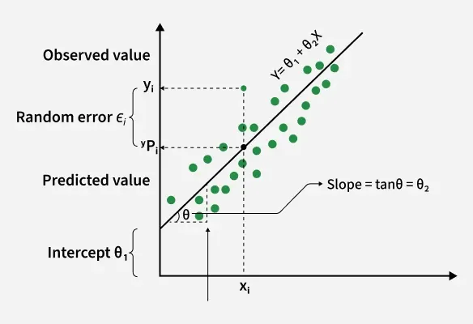
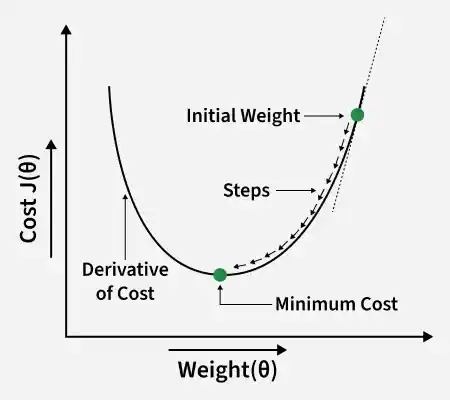
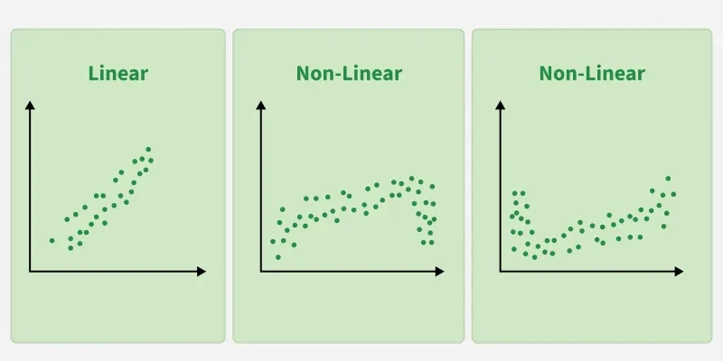
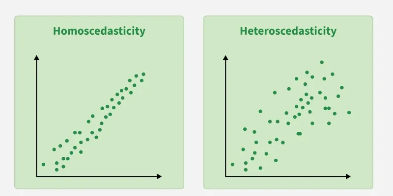

# La Régression Linéaire

### Qu'est-ce que la régression linéaire ?
- C'est un algorithme fondamental d'apprentissage supervisé (*supervised machine learning*) utilisé pour modéliser la relation entre une variable dépendante (à prédire) et une ou plusieurs variables indépendantes (caractéristiques d'entrée). Elle prédit des valeurs continues en trouvant la droite qui représente au mieux les données.
- Elle suppose qu'il existe une relation linéaire entre les entrées et la sortie.
- Elle utilise une **droite de meilleur ajustement** pour effectuer des prédictions.
- Elle est couramment utilisée en prévision, en analyse de tendances et en modélisation prédictive.

> *Exemple :* Supposons que nous souhaitions prédire la note d'examen d'un étudiant en fonction du nombre d'heures d'étude. Plus le nombre d'heures augmente, plus les notes ont tendance à augmenter également.

---

## 1. La droite de meilleur ajustement (*Best Fit Line*)
En régression linéaire, la droite de meilleur ajustement est la ligne droite qui représente au mieux la relation entre les variables indépendantes et dépendantes. L'objectif est de minimiser l'écart entre les points de données réels et les valeurs prédites par le modèle.

### Objectif de la droite de meilleur ajustement :
L'objectif est de trouver une droite qui minimise l'erreur (la différence) entre les points observés et les valeurs prédites, afin de pouvoir prédire avec précision la variable dépendante pour de nouvelles données invisibles.

- $Y$ est appelée la **variable dépendante** ou **variable cible** (target).
- $X$ est appelée la **variable indépendante** ou **prédicteur**.
- $\theta_1$ (ou $\beta_0$) représente l'**ordonnée à l'origine** (*intercept*), qui est la valeur de $Y$ lorsque $X = 0$.
- $\theta_2$ (ou $\beta_1$) représente la **pente** (*slope*), qui indique de combien $Y$ varie pour une modification d'une unité de $X$.

Une fonction linéaire est le type de fonction le plus simple. Ici, $X$ peut représenter une seule caractéristique (régression simple) ou plusieurs caractéristiques (régression multiple).

---

## 2. Équation de la droite
Pour une **régression linéaire simple** (avec une seule variable indépendante), la droite est représentée par l'équation :
$$y = mx + b$$

Où :
- $y$ est la valeur prédite.
- $x$ est l'entrée (la caractéristique).
- $m$ est la pente de la droite.
- $b$ est l'ordonnée à l'origine.

Le modèle cherche à optimiser les valeurs de $m$ et de $b$ pour que les valeurs prédites de $y$ soient aussi proches que possible des points de données réels.

---

## 3. Minimisation de l'erreur : La méthode des moindres carrés
Pour déterminer la droite idéale, on utilise la **méthode des moindres carrés** (*least squares method*), qui minimise les écarts entre les valeurs réelles et prédites. Ces écarts sont appelés **résidus**.

La formule d'un résidu est :
$$\text{Résidu} = y_i - \hat{y}_i$$

Où :
- $y_i$ est la valeur réelle observée.
- $\hat{y}_i$ est la valeur prédite par le modèle pour ce même point.

La méthode des moindres carrés minimise la somme des carrés des résidus (RSS - *Residual Sum of Squares*) :
$$\sum_{i=1}^{n} (y_i - \hat{y}_i)^2$$
Cette approche garantit que la droite représente le mieux possible l'ensemble des données en réduisant l'impact des erreurs globales.

---

## 4. Interprétation des paramètres
- **Pente ($m$ ou $\beta_1$) :** Indique l'ampleur du changement de la variable dépendante pour chaque augmentation unitaire de la variable indépendante.
- **Ordonnée à l'origine ($b$ ou $\beta_0$) :** Représente la valeur attendue de $y$ lorsque $x = 0$.

---

## La fonction d'hypothèse
La fonction d'hypothèse est l'équation mathématique utilisée pour faire des prédictions.

- **Pour une régression linéaire simple :**
  $$h(x) = \beta_0 + \beta_1x$$
- **Pour une régression linéaire multiple :**
  $$h(x_1, x_2, ..., x_k) = \beta_0 + \beta_1x_1 + \beta_2x_2 + ... + \beta_kx_k$$
  Où $\beta_1, \beta_2, ..., \beta_k$ mesurent l'influence spécifique de chaque variable indépendante $x_k$ sur la sortie.

---

## La fonction de coût
La fonction de coût mesure l'écart global entre les prédictions ($\hat{y}$) et les valeurs réelles ($y$). La fonction de coût la plus courante est l'**erreur quadratique moyenne** (*Mean Squared Error* - MSE) :

$$J(\theta) = \frac{1}{n} \sum_{i=1}^{n} (\hat{y}_i - y_i)^2$$

Où $\hat{y}_i = \theta_1 + \theta_2x_i$. Pour minimiser cette fonction de coût et trouver les paramètres optimaux, on utilise un algorithme d'optimisation tel que la **descente de gradient**.

---

## La Descente de Gradient (*Gradient Descent*)
C'est un algorithme d'optimisation itératif utilisé pour entraîner le modèle en minimisant l'erreur de prédiction.

### Fonctionnement :
1. Démarrer avec des valeurs aléatoires pour les paramètres (pente et ordonnée à l'origine).
2. Calculer l'erreur globale (via la fonction de coût).
3. Calculer le gradient (la dérivée) pour déterminer dans quelle direction modifier les paramètres afin de réduire l'erreur.
4. Mettre à jour les paramètres par petits pas (taux d'apprentissage).
5. Répéter l'opération jusqu'à ce que l'erreur atteigne un minimum (convergence).

---

## Types de régression linéaire
- **Régression linéaire simple (ou univariée) :** Lorsqu'il n'y a qu'une seule variable explicative ($X$).
- **Régression linéaire multiple (ou multivariée) :** Lorsqu'il y a deux variables explicatives ou plus.

---

## Hypothèses fondamentales de la régression linéaire
Pour garantir la fiabilité statistique des résultats du modèle, plusieurs hypothèses doivent être respectées :

1. **Linéarité :** La relation entre les entrées ($X$) et la sortie ($Y$) doit être globalement linéaire. 
2. **Indépendance des erreurs :** Les erreurs de prédiction (résidus) doivent être indépendantes les unes des autres.
3. **Variance constante (Homoscédasticité) :** Les erreurs doivent présenter une dispersion égale à travers toutes les valeurs d'entrée. Si la dispersion change (en s'élargissant ou se réduisant), on parle d'**hétéroscédasticité**, ce qui nuit à la fiabilité du modèle. 
4. **Normalité des erreurs :** Les erreurs de prédiction doivent suivre une distribution normale (en forme de cloche).
5. **Absence de multicolinéarité :** (Pour la régression multiple) Les variables explicatives ne doivent pas être trop fortement corrélées entre elles.
6. **Absence d'autocorrélation :** Les erreurs ne doivent pas présenter de motifs répétitifs (particulièrement critique pour les séries temporelles).
7. **Additivité :** L'effet combiné de plusieurs variables sur $Y$ est la somme de leurs effets individuels (pas d'effets d'interaction complexes non modélisés).

---

## Métriques d'évaluation
Plusieurs métriques permettent d'évaluer la performance et la robustesse d'un modèle de régression :

- **MSE (*Mean Squared Error*) :** Calcule la moyenne des carrés des écarts entre valeurs réelles et prédites (pénalise lourdement les grandes erreurs).
- **MAE (*Mean Absolute Error*) :** Calcule la moyenne des valeurs absolues des écarts (plus robuste face aux valeurs aberrantes).
- **RMSE (*Root Mean Squared Error*) :** Racine carrée de la MSE, exprimée dans la même unité que la variable cible.
- **R-deux ($R^2$) ou Coefficient de détermination :** Indique la proportion de variance de la variable cible expliquée par le modèle (généralement entre 0 et 1).
- **$R^2$ ajusté :** Version du $R^2$ qui pénalise l'ajout de variables inutiles ou non pertinentes.

---

## Techniques de régularisation
Pour éviter le surapprentissage (*overfitting*) lorsque le modèle est trop complexe :
- **Régression Lasso ($L_1$) :** Ajoute une pénalité proportionnelle à la valeur absolue des coefficients, ce qui peut annuler certains coefficients (sélection de variables).
- **Regression Ridge ($L_2$) :** Ajoute une pénalité proportionnelle au carré des coefficients, utile en présence de forte multicolinéarité.
- **Elastic Net :** Combine les pénalités des régression Lasso et Ridge ($L_1$ et $L_2$).

---

## Avantages
- Modèle simple, rapide à implémenter et doté de coefficients facilement interprétables.
- Très efficace sur le plan computationnel, adapté aux grands volumes de données et au temps réel.
- Excellent modèle de référence (*baseline*) pour des tâches de Machine Learning.
- Largement pris en charge par l'ensemble des bibliothèques de science des données.

---

## Limitations
- Repose sur l'hypothèse forte d'une relation linéaire entre les variables.
- Très sensible aux **valeurs aberrantes** (*outliers*), qui peuvent altérer significativement la pente de la droite.
- Vulnérable en cas de forte multicolinéarité entre les caractéristiques.
- Nécessite un travail rigoureux de préparation des données (*feature engineering*).
- Limité pour capturer des dynamiques ou des relations complexes non linéaires.