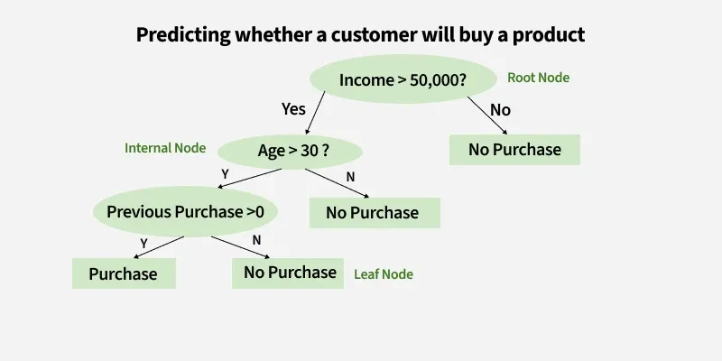
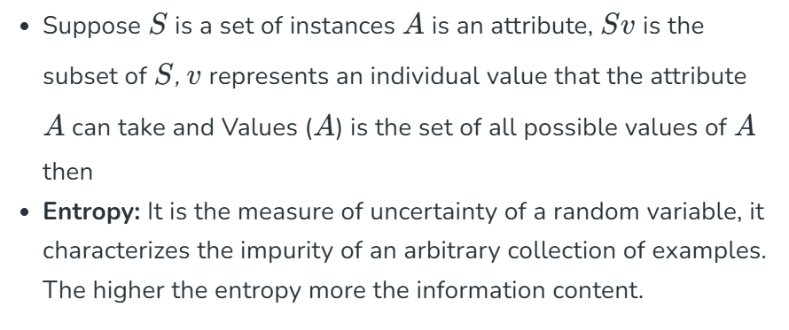
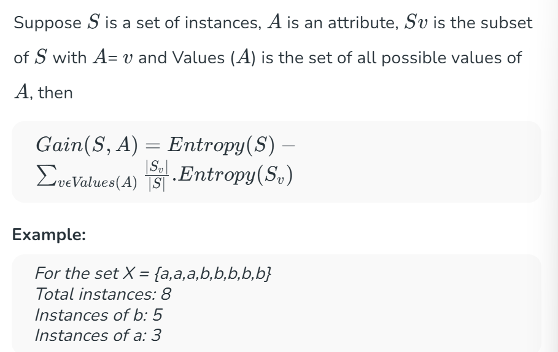
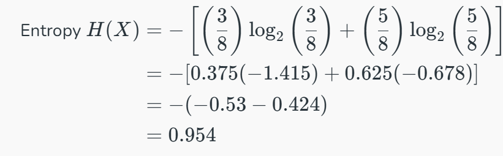
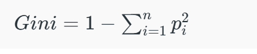

# Les Arbres de Décision en Apprentissage Automatique

### Qu'est-ce qu'un arbre de décision ?
Un arbre de décision est un algorithme d'apprentissage supervisé utilisé à la fois pour les tâches de classification et de régression. Il possède une structure hiérarchique en forme d'arbre qui se compose d'un nœud racine, de branches, de nœuds internes et de nœuds feuilles. Il fonctionne comme un organigramme qui aide à prendre des décisions étape par étape, où :
- Les nœuds internes représentent des tests d'attributs.
- Les branches représentent les valeurs des attributs.
- Les nœuds feuilles représentent les décisions finales ou les prédictions.

Les arbres de décision sont largement utilisés en raison de leur interprétabilité, de leur flexibilité et de leurs faibles besoins de prétraitement (*preprocessing*).

---

## Comment fonctionne un arbre de décision ?
Un arbre de décision divise l'ensemble de données en fonction des valeurs des caractéristiques pour créer des sous-ensembles purs ; idéalement, tous les éléments d'un groupe appartiennent à la même classe. Chaque nœud feuille représente le résultat final, qui peut être une étiquette de classe (en classification) ou une valeur continue (en régression).

---

## Le gain d'information et l'indice de Gini dans les arbres de décision
Passons aux mesures de sélection des attributs d'un arbre de décision. Nous disposons de deux mesures de sélection populaires :

### 1. Le Gain d'information
Il nous indique l'utilité d'une question (ou d'une caractéristique) pour diviser les données en groupes. Il mesure la réduction de l'incertitude après la division. Une bonne question créera des groupes plus clairs, et la caractéristique ayant le gain d'information le plus élevé est choisie pour prendre la décision.
- Par exemple, si nous divisons un ensemble de données de personnes en « Jeunes » et « Âgés » en fonction de l'âge et que tous les jeunes ont acheté le produit tandis que tous les âgés ne l'ont pas acheté, le gain d'information serait élevé car la division sépare parfaitement les deux groupes sans qu'il ne reste d'incertitude.

Par exemple, si un ensemble de données comporte un nombre égal de résultats Oui et Non (comme 3 personnes qui ont acheté un produit et 3 qui ne l'ont pas acheté), l'entropie est élevée car il est incertain de prédire quel résultat va se produire. Mais si tous les résultats sont identiques (tous Oui ou tous Non), l'entropie est de 0, ce qui signifie qu'il ne reste aucune incertitude dans la prédiction du résultat.

### L'essentiel pour construire un arbre de décision à l'aide du gain d'information :
- Commencer avec toutes les instances d'entraînement associées au nœud racine.
- Utiliser le gain d'information pour choisir l'attribut avec lequel étiqueter chaque nœud.
- Construire récursivement chaque sous-arbre sur le sous-ensemble d'instances d'entraînement qui seraient classées le long de ce chemin dans l'arbre.
- S'il ne reste que des instances d'entraînement positives ou négatives, étiqueter ce nœud par Oui ou par Non en conséquence.
- S'il ne reste aucun attribut, étiqueter avec un vote majoritaire des instances d'entraînement restantes à ce nœud.
- S'il ne reste aucune instance, étiqueter avec un vote majoritaire des instances d'entraînement du parent.

---

### 2. L'indice de Gini
C'est une métrique qui mesure la fréquence à laquelle un élément choisi au hasard serait mal identifié. Cela signifie qu'un attribut ayant un indice de Gini plus faible doit être préféré. Scikit-learn prend en charge le critère « Gini » pour l'indice de Gini et utilise par défaut cette valeur.

Par exemple, si nous avons un groupe de personnes où tout le monde a acheté le produit (100 % de « Oui »), l'indice de Gini est de 0, ce qui indique une pureté parfaite. Mais si le groupe présente un mélange égal de « Oui » et de « Non », l'indice de Gini serait de 0,5, ce qui montre une forte impureté ou incertitude. La formule de l'indice de Gini est donnée par :

#### Caractéristiques supplémentaires de l'indice de Gini :
1. Il est calculé en additionnant les probabilités au carré de chaque résultat dans une distribution et en soustrayant le résultat de 1.
2. Un indice de Gini plus faible indique une distribution plus homogène ou pure, tandis qu'un indice de Gini plus élevé indique une distribution plus hétérogène ou impure.
3. L'indice de Gini est utilisé pour évaluer la qualité d'une division en mesurant la différence entre l'impureté du nœud parent et l'impureté pondérée des nœuds enfants.
4. Par rapport à d'autres mesures d'impureté comme l'entropie, l'indice de Gini est plus rapide à calculer et plus sensible aux changements des probabilités de classe.
5. Un inconvénient de l'indice de Gini est qu'il a tendance à privilégier les divisions qui créent des sous-nœuds de taille égale, même s'ils ne sont pas optimaux pour la précision de la classification.
6. En pratique, le choix entre l'utilisation de l'indice de Gini ou d'autres mesures d'impureté dépend du problème spécifique et du jeu de données, et nécessite de l'expérimentation et du réglage (*tuning*).

---

## Comprendre l'arbre de décision avec un cas d'utilisation réel
Jusqu'à présent, nous avons examiné les attributs et les composants d'un arbre de décision. Passons maintenant à un cas d'utilisation concret pour illustrer son fonctionnement étape par étape.

### Étape 1 : Commencer avec l'ensemble de données complet
Nous commençons avec l'ensemble des données, traitées comme le nœud racine de l'arbre de décision.

### Étape 2 : Choisir la meilleure question (attribut)
Sélectionnez la meilleure question pour diviser l'ensemble de données. Par exemple, demandez : « Quel est le temps (*outlook*) ? »
- **Réponses possibles :** Ensoleillé (*Sunny*), Nuageux (*Cloudy*) ou Pluvieux (*Rainy*).

### Étape 3 : Diviser les données en sous-ensembles
Répartissez l'ensemble de données en groupes en fonction de la réponse :
- S'il fait beau (*sunny*) -> un premier sous-ensemble.
- S'il fait nuageux (*cloudy*) -> un deuxième sous-ensemble.
- S'il pleut (*rainy*) -> le dernier sous-ensemble.

### Étape 4 : Diviser davantage si nécessaire (division récursive)
Pour chaque sous-ensemble mixte, posez une nouvelle question pour affiner les groupes. Par exemple, si le sous-ensemble ensoleillé est mitigé, demandez :
*« L'humidité est-elle élevée ou normale ? »*
- Humidité élevée -> « Natation (*Swimming*) ».
- Humidité normale -> « Randonnée (*Hiking*) ».

### Étape 5 : Attribuer les décisions finales (nœuds feuilles)
Lorsqu'un sous-ensemble ne contient plus qu'une seule activité, arrêtez la division et attribuez-lui une étiquette :
- Nuageux -> « Randonnée (*Hiking*) ».
- Pluvieux -> « Rester à l'intérieur (*Stay Inside*) ».
- Ensoleillé + Humidité élevée -> « Natation (*Swimming*) ».
- Ensoleillé + Humidité normale -> « Randonnée (*Hiking*) ».

### Étape 6 : Utiliser l'arbre pour les prédictions
Pour prédire une activité, suivez les branches de l'arbre pas à pas. 
*Exemple :* Si le temps est Ensoleillé (*Sunny*) et que l'humidité est Élevée (*High*) :
- Commencer par le temps (*Outlook*).
- Prendre la branche pour Ensoleillé.
- Aller ensuite à l'humidité (*Humidity*) et prendre la branche pour Humidité élevée.
- Résultat final : « Natation (*Swimming*) ».